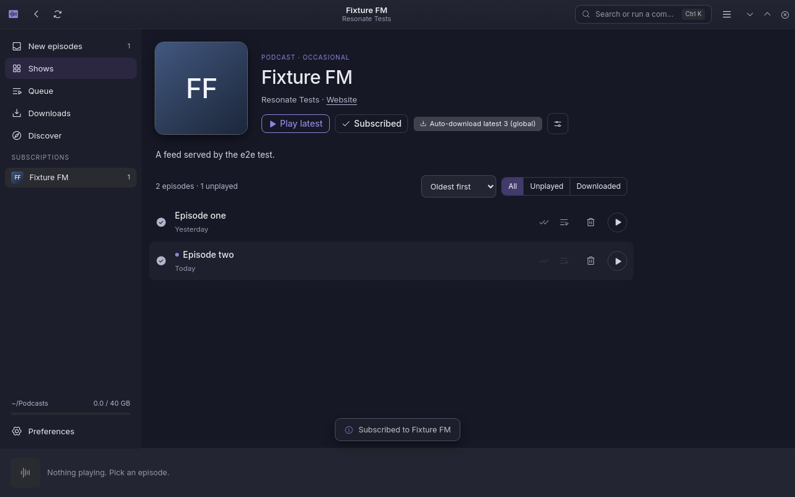
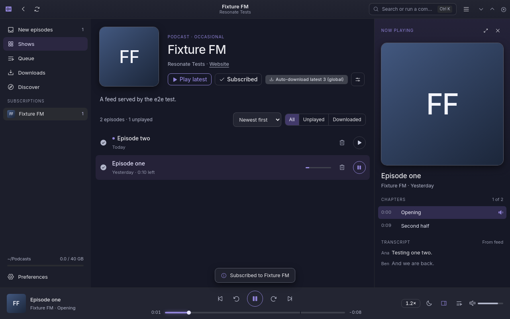
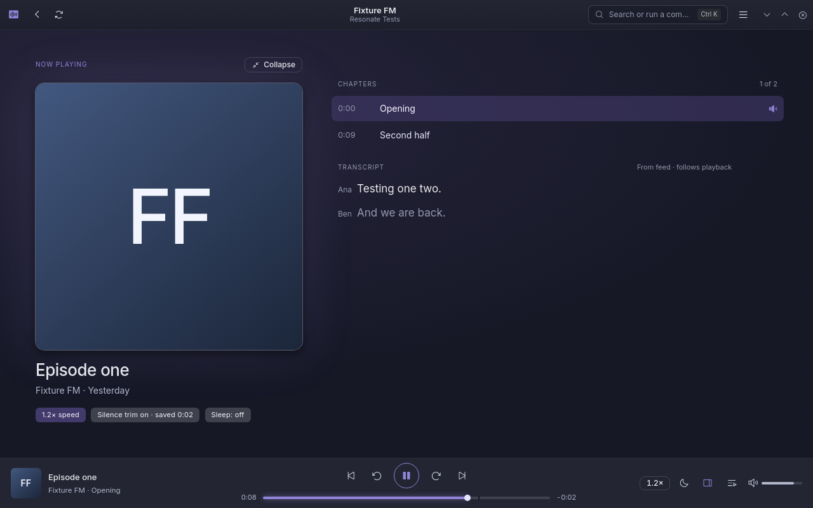
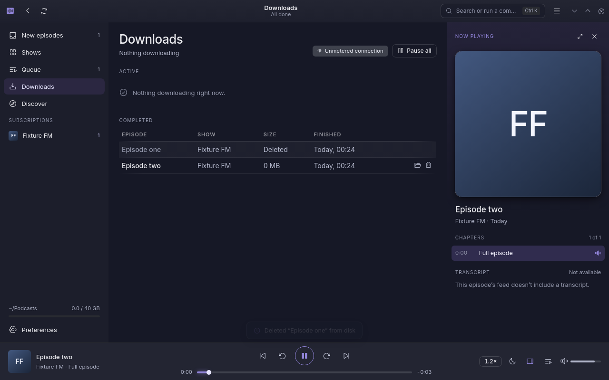

# Resonate

[](https://github.com/sekhnat/ResonatePod/actions/workflows/ci.yml)
[](https://github.com/sekhnat/ResonatePod/releases/latest)


A podcast downloader and player for the Linux desktop.

Resonate subscribes to RSS feeds, downloads episodes in the background, and plays them with
resume, chapters, transcripts and silence trimming. It is an Electron app with a React UI built on
the **Nocturne** design system (dark, compact, Inter, Phosphor icons).

## Contents

- [Highlights](#highlights)
- [Screenshots](#screenshots)
- [Installation](#installation)
- [Features](#features)
- [Keyboard shortcuts](#keyboard-shortcuts)
- [Your data](#your-data)
- [Development](#development)
- [Project layout](#project-layout)
- [Releasing](#releasing)
- [Known limitations](#known-limitations)
- [License](#license)

## Highlights

- **Subscribe your way:** by RSS URL, OPML import, or the built-in directory search.
- **Private feeds:** token URLs and HTTP Basic auth, with credentials kept in the system keyring.
- **Offline-ready:** automatic downloads with resume and retry, and storage limits that clean up for you.
- **Rich playback:** chapters (from the feed or the file), synced transcripts, silence trimming and a sleep timer.
- **Sync:** two-way subscriptions and play positions through gpodder.net, oPodSync or Nextcloud.
- **Native feel:** system tray, MPRIS media keys, desktop notifications and login autostart.

## Screenshots

Captured from the packaged app by the end-to-end test, running under Xvfb against a local fixture
feed.

| | |
| --- | --- |
|  |  |
| **Show page:** sort and filter the episode list. | **Now playing:** chapters and a transcript that follows playback. |
|  |  |
| **Full view:** chapters, transcript and playback settings. | **Downloads:** progress, history and storage. |

To regenerate them, run the e2e test with `E2E_SHOTS=<dir>` set and copy the images you want:

```bash
E2E_SHOTS=/tmp/shots xvfb-run -a npm run test:e2e
```

## Installation

Download the latest build from [Releases](https://github.com/sekhnat/ResonatePod/releases/latest).
Every release includes a `SHA256SUMS.txt` to verify the files.

| Package | Install |
| --- | --- |
| **AppImage** (any distribution) | `chmod +x Resonate-*.AppImage && ./Resonate-*.AppImage` |
| **Debian / Ubuntu** (`.deb`) | `sudo apt install ./resonate_*_amd64.deb` |

The `.deb` depends on `libnotify4` and `libsecret-1-0`, which `apt` installs for you.

## Features

### Subscriptions and feeds

| Area | What it does |
| --- | --- |
| **Subscriptions** | Subscribe by RSS URL, from Discover, or by OPML import and export. Feeds are re-checked hourly and on <kbd>Ctrl</kbd>+<kbd>R</kbd>, using ETag / Last-Modified. New episodes land in *New episodes*, with optional desktop notifications. Moved feeds are followed: permanent redirects (301/308) and `itunes:new-feed-url` update the stored address. |
| **Feed formats** | RSS 2.0 with iTunes tags, Podcasting 2.0 `podcast:chapters` and `podcast:transcript`, and Podlove Simple Chapters. Show notes are shown as plain text. |
| **Private feeds** | Token URLs (Patreon, Supercast, …) work as they are. Feeds behind HTTP Basic auth ask for a username and password, or take them from a pasted `https://user:pass@…` URL. Credentials are stored per server, encrypted with the system keyring, and also sent for enclosures on the same server. *Feed login…* in a show's settings changes them. |
| **Discover** | Searches Apple Podcasts ([Search API](https://performance-partners.apple.com/search-api)), [gpodder.net](https://gpodder.net/) and fyyd at once, plus [Podcast Index](https://api.podcastindex.org/) with your own free API key. Results are merged AntennaPod-style (each directory's rank, weighted and summed per feed), or you can search a single directory. *Suggested for you* shows Apple's top chart for your region minus shows you follow, led by gpodder.net's personal suggestions when sync is connected. Browse Apple's regional charts or gpodder.net's most subscribed by category. Pasting an Apple Podcasts link subscribes to the show's real feed. |

### Listening

| Area | What it does |
| --- | --- |
| **Episode lists** | Sort a show's episodes, or the *New episodes* inbox, by newest, oldest, longest, shortest, title (A–Z or Z–A) or unplayed first. Filter by All, Unplayed or Downloaded. Each show remembers its own sort, and the inbox has its own. |
| **Playback** | Streams, or plays the downloaded file. Resumes where you left off. Speed changes keep pitch. Skip intervals, chapter skip, a draggable seek bar, volume and mute. |
| **Video podcasts** | Video episodes show their picture in *Now playing* (double-click for full screen). Audio keeps all the usual controls. |
| **Silence trim** | Web Audio level detection plays quiet stretches at 3×. The time saved is tracked. |
| **Chapters and transcripts** | A clickable chapter list, from the feed or, failing that, from inside the file: ID3 `CHAP` frames (MP3) or Nero `chpl` (M4A), read from disk or with a few small Range requests while streaming. VTT, SRT, JSON and timed HTML transcripts follow playback. HTML and plain-text transcripts without timestamps are shown as text. |
| **Queue** | Drag to reorder, play next, remove, clear. The next item plays automatically when an episode ends. |
| **Sleep timer** | 15, 30 or 60 minutes, end of chapter, or end of episode. |
| **Command palette** | <kbd>Ctrl</kbd>+<kbd>K</kbd> searches commands, shows and episodes. |

### Downloads and storage

| Area | What it does |
| --- | --- |
| **Downloads** | Saved to `~/Podcasts/<Show>/<date> - <title>.<ext>`. Concurrency limit, pause and resume (HTTP Range), cancel, delete, and *Show in Files*. Network errors, stalls and server errors are retried with backoff (5 s up to 5 min), resuming from the partial file. Failed downloads stay listed with *Retry*. Interrupted downloads resume when Resonate starts again. |
| **Auto-download** | A global *keep latest N* rule, overridable per show. |
| **Storage** | Played files are deleted after 1 day or 1 week, checked hourly. A storage limit removes the oldest played files first. Changing the download folder offers to move existing downloads. Downloads pause on metered connections (NetworkManager, via `nmcli`). |
| **Per-show settings** | Auto-download, playback speed, silence trim and intro skip. |

### Sync and desktop integration

| Area | What it does |
| --- | --- |
| **Sync** | gpodder.net API v2 (also oPodSync and Nextcloud gPodder Sync): two-way subscriptions and play positions. The password is stored in the system keyring through Electron `safeStorage`. |
| **Desktop** | A frameless window whose header bar is the title bar (KDE or GNOME style, picked from `XDG_CURRENT_DESKTOP`). Close goes to the tray. The tray menu has playback, sleep timer, up next, downloads, refresh, open and quit. MPRIS media keys and widgets work through MediaSession. Window size and position are remembered. *Start Resonate when you log in* writes an XDG autostart entry that opens hidden in the tray. |

## Keyboard shortcuts

| Keys | Action |
| --- | --- |
| <kbd>Space</kbd> | Play / pause |
| <kbd>←</kbd> / <kbd>→</kbd> | Skip back / forward |
| <kbd>Ctrl</kbd>+<kbd>K</kbd> | Command palette |
| <kbd>Ctrl</kbd>+<kbd>R</kbd> | Refresh feeds |
| <kbd>Ctrl</kbd>+<kbd>1</kbd>–<kbd>5</kbd> | Switch section |
| <kbd>Ctrl</kbd>+<kbd>O</kbd> / <kbd>Ctrl</kbd>+<kbd>E</kbd> | Import / export OPML |
| <kbd>Ctrl</kbd>+<kbd>,</kbd> | Preferences |
| <kbd>Ctrl</kbd>+<kbd>/</kbd> | Show all shortcuts |
| <kbd>Ctrl</kbd>+<kbd>W</kbd> | Close to tray |
| <kbd>Ctrl</kbd>+<kbd>Q</kbd> | Quit |

## Your data

Everything lives in `~/.config/Resonate/`:

| File | Contents |
| --- | --- |
| `library.db` | Subscriptions, episodes and their show notes, episode state, queue, preferences and per-show settings (SQLite) |
| `window.json` | Window size and position |
| `secrets.json` | Encrypted sync password, feed logins and Podcast Index key |
| `main-settings.json` | The download folders Resonate may read and write |
| `library.json.bak` | Only if you used an earlier version: your library as it was before it moved into `library.db` |

Only what changes is written to the library, a moment after it changes. The playback position is
saved every 30 seconds while playing, on pause, and on quit. Downloaded episodes stay in your
download folder (`~/Podcasts` by default) when you unsubscribe.

## Development

Requirements: Node.js 22 and npm.

```bash
npm install
npm run dev          # Vite + Electron with reload
npm run typecheck    # tsc -b
npm test             # unit tests (Vitest)
npm run test:e2e     # builds, then drives the app end to end (use `xvfb-run -a` on a headless box)
npm run dist         # release/Resonate-<version>.AppImage and resonate_<version>_amd64.deb
```

`npm run dev:web` runs the UI in a plain browser. It can only stream and has no downloads, and many
feeds won't load there because of CORS.

`npm run icons` regenerates `assets/*.png` from the SVGs. It needs `playwright` with Chromium
installed.

### Continuous integration

`.github/workflows/ci.yml` runs on every push and pull request: typecheck, unit tests and the
Electron end-to-end test, then it builds the AppImage and `.deb` and smoke-tests the packaged app.
The packages are kept on the run for 7 days. Include `[skip ci]` in a commit message to skip the
run, for example for documentation-only changes.

## Project layout

```
electron/        Main process: window, media protocol (local files and proxied streams with Range),
                 download manager, tray, dialogs, nmcli, secrets, IPC; preload bridge
shared/          Code used on both sides: feed parser, chapters and transcripts, embedded chapters
                 (ID3/MP4), gpodder client, types
src/
  platform.ts    Typed bridge to the main process, with a browser fallback
  store.ts       Zustand store: library, playback state, downloads, rules, sync
  model.ts       Episode rows plus filtering and sorting for the lists
  lib/directory/ Apple, gpodder.net, fyyd and Podcast Index clients; combined search and suggestions
  audio/         The playback engine (one media element + Web Audio + MediaSession)
  services.ts    Wires the store to downloads, tray, network checks and timers
  screens/       One file per screen
  components/    Shared UI
e2e/run.mjs      Playwright-driven Electron test against a local feed server (directories are served
                 from test/fixtures/directory via the RESONATE_URL_REWRITE test hook)
test/fixtures/   Sample feed, chapters, transcript, and small media files (chaptered MP3/M4A, video)
```

## Releasing

1. Bump `version` in `package.json` (and `package-lock.json`): `npm version <x.y.z> --no-git-tag-version`.
2. Commit, then tag and push: `git tag v<x.y.z> && git push origin main v<x.y.z>`.

CI checks that the tag matches the `package.json` version, then attaches the AppImage, `.deb` and
`SHA256SUMS.txt` to a GitHub release with generated notes.

## Known limitations

- The tray uses StatusNotifierItem. GNOME needs the AppIndicator extension to show it.
- Linux only. Metered-connection detection needs NetworkManager (`nmcli`).

## License

MIT, as declared in `package.json`.
